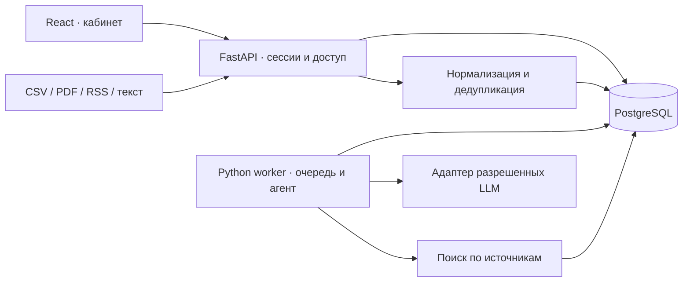

# Архитектура

## Контекст и персонализация

Исходные признаки хранят значение, статус и источник. Расчетные признаки строятся на доступной выборке. Финансовые характеристики контрагентов не возвращаются как профиль другого клиента. Общие физлица показывают связь, но не доказывают владение. `GROUP_ID` задает группу; сумма выручек не интерпретируется как консолидированная выручка.

Права пользователя ограничивают контекст до ранжирования и передачи модели. Для недоступных контрагентов сохраняются только платежи выбранной компании и условные обозначения: отрасль, регион и идентификаторы чужого профиля исключаются. Состав доступных компаний фиксируется в запуске; при сокращении доступа старый результат и цепочка уточнений блокируются, а новый анализ строится заново. Worker повторно проверяет права перед обработкой. Для запусков старой версии без снимка прав требуется новый анализ.

Скоринг учитывает продукты, темы, отрасль, регион в заголовке, концентрацию платежей, отрасли связанных компаний, роль, свежесть и число источников. Это объяснимая эвристика, а не откалиброванная вероятность риска. Извлечение тем — словарный baseline; в live дополнительно работает разрешенная модель. В PostgreSQL полнотекстовый индекс использует русский словарь, тематический/лексический поиск расширяет кандидатов. В SQLite используется только лексический поиск. Для больших корпусов потребуется индексированный отбор по темам вместо просмотра последних 500 документов.

## Агент

Состояние: контекст компании, событие, роль, план, предыдущий ответ, доказательства, проверки. Планировщик выбирает запросы и инструменты из фиксированного набора. Чтение исходной новости, поиск банковской аналитики и проверка всегда обязательны. При недостатке данных — до двух дополнительных циклов. Все этапы записываются в `Run.trace`; скрытые рассуждения не сохраняются.

`facts`, `bank_view`, `impact`, `risks`, `opportunities`, `actions`, `answer` содержат утверждения со ссылками на фрагменты и признаками компании. Код проверяет существование ссылок, принадлежность банковских источников и числовые основания. Отдельный LLM-вызов проверяет содержание. Это снижает риск, но не доказывает фактическую точность автоматически. После неуспешной проверки неподтвержденная персональная интерпретация не публикуется.

Источники после даты события не подмешиваются в его историческую интерпретацию. Банковские материалы старше 90 дней маркируются историческими. Реальные новости доступны всем компаниям, синтетические — только учебным. Корпус доказательств определяется событием: для реальной новости нельзя использовать синтетическую аналитику банка даже при учебном профиле компании. Уточняющий вопрос наследует предыдущий результат и запускает новый поиск.

## Очередь и отказоустойчивость

PostgreSQL использует `FOR UPDATE SKIP LOCKED`, SQLite — условный атомарный update. Lease обновляется после каждого этапа. После остановки worker просроченные задачи возвращаются в очередь; после трех попыток завершаются ошибкой. Потеря worker во время LLM-вызова может приводить к повторной оплате; ключи идемпотентности провайдера нужно подключать только при подтвержденной поддержке.

Сбор RSS работает в отдельном потоке worker и не блокирует разборы. Таблица `feed_states` хранит последний отчет, срок следующего обновления и lease на источник с уникальным токеном. Ручной импорт и планировщик используют одно атомарное получение lease; heartbeat продлевает его перед каждой статьей. После остановки сборщика другой worker продолжит работу по истечении lease. По умолчанию цикл — 30 минут, максимум 50 статей на источник за проход. В документе `ingestion_meta` сохраняются способ извлечения, полнота, время загрузки и предупреждение. Интерфейс опрашивает статус и ленту раз в 15 секунд без сброса открытого разбора.

Кеш включает пользователя, его доступ к компаниям, компанию, роль, событие, вопрос, идентификаторы моделей и версию промпта, корпус и связи. Исходные документы неизменяемы в API; повторный импорт одной публикации не создает копию. Издатель, URL, заголовок и дата входят в идентичность публикации: одинаковый текст из разных источников сохраняет отдельные основания. Изменения корпуса инвалидируют результаты. При большом объеме следует перейти от полного fingerprint к версионированию корпуса и профиля.

## Безопасность

- HttpOnly cookie, SameSite, Secure в production, серверная сессия с истечением срока, PBKDF2-пароли.
- Все записи анализа принадлежат пользователю; доступ к компании проверяется перед чтением, запуском и вопросом.
- Изменяющие запросы требуют custom header и разрешенный Origin; логин ограничен по попыткам.
- Только фиксированные HTTPS-источники; проверка адресов и перенаправлений, ограничение размера скачивания.
- Содержимое документов считается недоверенным, доступных инструментов выполнения кода нет. React экранирует текст; HTML из новостей удаляется.
- Модели и запросы проходят единый шлюз; лимиты контекста, ответа, повторов, задач пользователя и бюджета.
- Секреты только в окружении. Технические ошибки не возвращают ключи или сырые ответы провайдера.
- В LLM отправляется минимально необходимый обезличенный контекст; физические лица не деанонимизируются.

Для интеграции в настоящий банк потребуются банковская аутентификация, формальная модель полномочий, шифрование и политика хранения, аудит безопасности, управление секретами и согласование передачи клиентских данных. Данный проект — хакатонный прототип.
