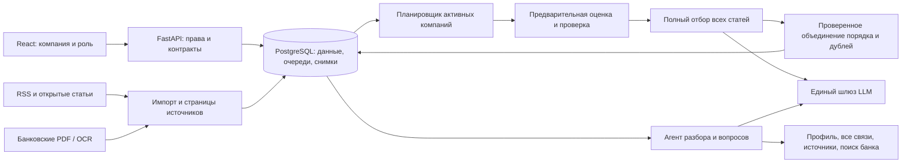

# Архитектура

Актуальная версия: `full-feed-v1`, 26.10.2026. Приложение не развёртывает веса LLM.

## Порядок и полнота

`semantic_ranking.py` даёт предварительные гипотезы, `full_selection.py` пересматривает **весь корпус**, включая нули. Решения для CEO/CFO/TREASURER: direct, scenario, irrelevant, insufficient. Прямое влияние не требует рассчитанной суммы; условный сценарий требует реального признака и применимого механизма. Цитаты проверяются по полному источнику.

Целые статьи упаковываются по техническому контексту (до 12 в одном классификационном пакете). Каждый пакет получает полный порядок и отдельную проверку всех положительных и отрицательных решений. Порядки объединяются сравнениями модели с проверкой. Сходство заголовков лишь предлагает межпакетные дубли; решение подтверждается по полным текстам. Источники и противоречия не удаляются. Подтверждённая группа целиком входит в состав последующего разбора.

Объём отдельной статьи не уменьшается ради окна контекста. Если она не помещается, возникает явная ошибка совместимости. Число сравнений растёт с размером корпуса: реальную пропускную способность локального сервера предстоит измерить. Кеш шагов снижает повторную работу при неизменных пакетах, моделях и инструкциях.

`GET /api/feed`: `company_id`, `role`, `corpus`, `scope=personal|all`, `q`, `topic`, `limit=1..100`, `offset`, `feed_version`. Ответ содержит items, total, next_offset, feed_version, list_selection, pipeline и основания релевантности. UI запрашивает по пять карточек; это размер страницы, не длина ленты. Поиск/фильтр применяется после ранжирования. «Все материалы» добавляет непрошедшие отбор статьи с явным статусом.

Снимок привязан к пользователю, контексту и фильтрам на 24 часа. Следующая страница продолжает прежний порядок. При изменении прав/профиля или параметров возвращается 409/404, а не смешанная лента. Поллинг предлагает обновить снимок, не переставляя открытые карточки.

## Очереди и автоматизация

RSS имеет расписание, lease источника, отчёт ошибок и идемпотентный импорт. `pipeline.py` для активных профилей ставит оценку → полный отбор по готовности зависимостей. Повторный тик не создаёт повторную задачу того же состава. Автоматическая цепочка разрешена только для local; remote требует явного запуска.

Worker имеет отдельные линии анализа и отбора. Heartbeat продлевает владение долгой задачей. Уникальный токен и проверка перед записью запрещают прежнему worker публиковать результат или ошибку после перехвата. Локальные прерванные задания восстанавливаются конечное число раз; платные повторы не выполняются без предусмотренных ограничений.

Добавление новости во время долгой сортировки позволяет опубликовать уже проверенный снимок и продолжить следующим поколением. Изменение/удаление его источника, профиля, модели или инструкций делает снимок неприменимым. Старый проверенный порядок при добавлении материалов явно обозначается устаревшим, а новые статьи не объявляются уже проверенными.

## Контекст и банк

`related_context` ищет по всем связям компании с пагинацией, направлением и запросом. Недоступные контрагенты обезличены; поиск не использует закрытые отрасли. Доступные участники группы возвращаются с признаками. Платёж не устанавливает тип договора, ФТС — направление/валюту, депозит — свободный остаток, а кредит — сумму и ставку.

Поиск банка работает по разделам/страницам, расширяет запрос синонимами и объединяет позиции выдач reciprocal-rank fusion. Предметная проверка отсеивает неподходящие темы; модель отдельно определяет применимость кандидатов. Она получает контекст целой страницы, но цитируемый фрагмент остаётся точным. Изменение корпуса банка инвалидирует кеш разбора.

PDF хранится в `source_files`, метаданные страниц и текст — в PostgreSQL. Статусы: текст/ OCR/не извлечён; графики и числовые таблицы не проверены. Явно помеченные неподтверждённые table/chart не допускаются как числовые основания. Полная автоматическая интерпретация графиков не реализована; OCR нельзя выдавать за проверенное числовое извлечение.

## Безопасность и эксплуатация

HttpOnly/SameSite-сессии, Secure в production, проверка Origin/custom header, ограничение попыток входа. Права проверяются перед чтением, запуском и обработкой. Административные журналы недоступны viewer. Источники — недоверенные данные, инструменты агента заданы кодом, shell/SQL/платежей у модели нет. Загрузчики ограничены разрешёнными источниками и проверяют перенаправления; HTML очищается, React экранирует текст.

Локальный шлюз не расходует удалённую квоту и не передаёт ключ DeepSeek. Денежные ограничения действуют только для remote. Входные тексты не сокращаются; технические таймауты и окно настраиваются. При смене весов с тем же API ID менять `LLM_MODEL_REVISION`.

Для нагрузки следующего масштаба нужны измерения на выбранном сервере, инкрементальные версии корпуса вместо полного fingerprint, ограниченная конкурентность по возможностям GPU и отдельные worker-пулы. Для банковской эксплуатации — настоящее SSO, формальная модель полномочий, шифрование/политика хранения, управление секретами и аудит безопасности. Текущий результат — прототип.
